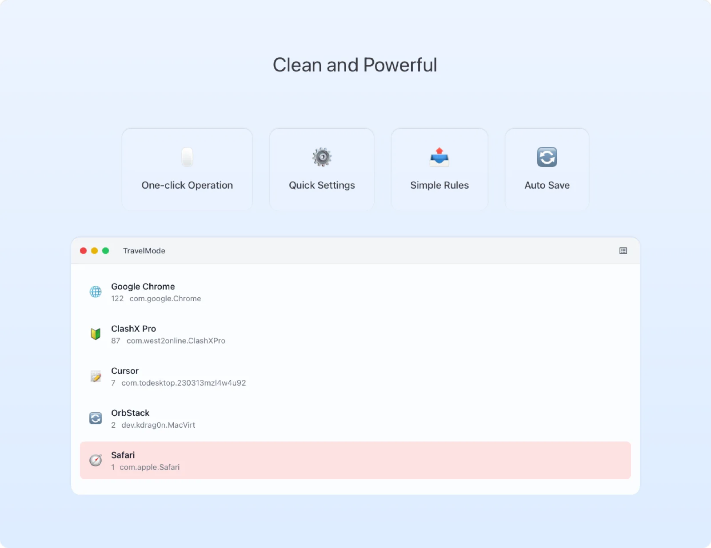

# TravelMode

TravelMode is a per-app network access control app for macOS. It asks for a decision on every new connection, lets you allow or block internet access for each application, and keeps a local history of what each app connected to.

📖 English | [中文版](README_zh.md)

[](https://apps.apple.com/cn/app/travelmode/id6474899051?mt=12)
[](https://github.com/CofficLab/Netto/releases)
[](https://www.apple.com/macos/)
[](https://swift.org)
[](https://coffic.cn)
[](https://coffic.cn/en/products/travelmode)



## Features

- **Per-app rules** — allow or block network access per application. Apps without a rule are allowed by default.
- **Connection timeline** — every new flow is recorded with its source app, direction, status, address, and time.
- **App list** — every app seen this session, with blocked apps highlighted and filters for all / allowed / blocked.
- **Event browser** — open an app to filter its events by status and direction, page through its history, and export as CSV.
- **Menu bar dashboard** — firewall state, start / stop, live per-app network speed, app rules, and connection history all live in the menu bar popover; the settings window opens only when needed.
- **Local-first storage** — rules and events are stored locally; nothing is sent to a server.
- **Built-in diagnostics** — browse the local database and recorded events from the settings window.

## How it works

TravelMode installs a macOS system extension that acts as a **content filter** (`NEFilterDataProvider`). Every new socket flow is paused briefly while the app decides, using the per-app rule stored locally, and an event is written to the local database. When TravelMode is not running or the system extension is not approved, the filter falls back to allow, so network access is never silently cut off.

TravelMode does not proxy, reroute, or decrypt traffic. It only decides whether a connection is allowed, so it can run alongside VPN and proxy tools such as Clash.

## Architecture

```text
App/  SwiftUI/AppKit host and composition root
    ↓
Packages/FactoryNetto        The only assembly point
Packages/KernelCore          Plugin lifecycle and provider registry
    ├─ Packages/Provider*    Capability contracts and neutral data types
    └─ Packages/Plugin*      Features, UI, and system services
Extension/ + Bridge/         Network Extension process and IPC boundary
```

- **App** hosts the SwiftUI scenes, AppKit lifecycle, and the status bar item.
- **FactoryNetto** assembles providers and plugins and controls startup order.
- **KernelCore** manages plugin lifecycle and provider registration/resolution without knowing concrete features.
- **Provider packages** define capability contracts such as firewall state, app rules, events, and settings.
- **Plugin packages** implement the dashboard, menu bar panel, database browser, and StoreKit integration.
- **Extension + Bridge** keep the filter process isolated and communicate only through the IPC contract.
- **LumiUI** provides the shared design system and components.

See [README-DEV.md](README-DEV.md) (Chinese) for the developer guide.

## Download

Download the latest release from the [App Store](https://apps.apple.com/cn/app/travelmode/id6474899051?mt=12).

## Requirements

- macOS 15.0 or later
- Swift 6.0

## Development

1. Open `TravelMode.xcodeproj` and select the `TravelMode` scheme.
2. Build and run from Xcode, or install the built `TravelMode.app` into `/Applications` and approve the system extension in **System Settings → General → Login Items & Extensions**.
3. Debug builds keep their data under `~/Documents/debug`; release builds use the sandbox container.

`README-DEV.md` covers the architecture, build products, and debugging notes in Chinese.
