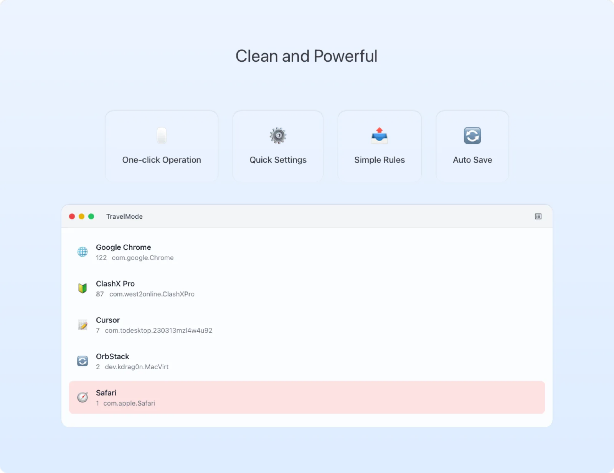

# TravelMode

TravelMode 是一款 macOS 平台的应用联网控制工具。它在每个新连接建立时做一次决策，让你按应用允许或阻止联网，并在本地记录每个应用连接过的地址与次数。

📖 [English](README.md) | 中文版

[](https://apps.apple.com/cn/app/travelmode/id6474899051?mt=12)
[](https://github.com/CofficLab/Netto/releases)
[](https://www.apple.com/macos/)
[](https://swift.org)
[](https://coffic.cn)
[](https://coffic.cn/en/products/travelmode)



## 功能特性

- **按应用控制** — 为每个应用单独允许或阻止联网；没有配置规则的应用默认允许。
- **连接时间线** — 记录每条新连接的来源应用、方向、状态、地址与时间。
- **应用列表** — 展示本次运行出现过的应用，已阻止的应用高亮，并支持全部 / 允许 / 阻止筛选。
- **事件浏览** — 在菜单栏弹窗中打开应用，按状态与方向筛选、分页查看历史，并把事件导出为 CSV。
- **菜单栏仪表盘** — 防火墙状态、开启 / 停止、实时应用网速、应用规则与连接历史全部收在菜单栏弹窗中，仅在需要时打开设置窗口。
- **本地优先** — 规则与事件只保存在本机，不上传服务器。
- **内置诊断** — 在设置窗口中浏览本地数据库与已记录的事件。

## 工作原理

TravelMode 安装一个 macOS 系统扩展作为**内容过滤器**（`NEFilterDataProvider`）。每条新的 socket 连接会短暂暂停，等待应用根据本地保存的按应用规则给出决定，同时写入一条事件记录。当 TravelMode 没有运行或系统扩展未获批准时，过滤器退化为放行，不会在无提示的情况下切断网络。

TravelMode 不做代理、不改路由、不解密流量，只决定连接是否放行，因此可以和 Clash 等代理 / VPN 工具同时使用。

## 架构设计

```text
App/  SwiftUI/AppKit 宿主与组合根
    ↓
Packages/FactoryNetto        唯一装配点
Packages/KernelCore          插件生命周期与 Provider 注册表
    ├─ Packages/Provider*    能力契约与中立数据类型
    └─ Packages/Plugin*      功能、界面与系统服务
Extension/ + Bridge/         独立的 Network Extension 进程与 IPC 边界
```

- **App**：承载 SwiftUI 场景、AppKit 生命周期与状态栏图标。
- **FactoryNetto**：装配 Provider 与插件，控制启动顺序。
- **KernelCore**：管理插件生命周期与 Provider 的注册/解析，不依赖具体功能。
- **Provider 包**：定义防火墙状态、应用规则、事件、设置等能力契约。
- **Plugin 包**：实现仪表盘、菜单栏面板、数据库浏览与 StoreKit 商店。
- **Extension + Bridge**：隔离过滤器进程，只通过 IPC 契约通信。
- **LumiUI**：共享设计系统与组件。

更完整的开发说明见 [README-DEV.md](README-DEV.md)。

## 下载

从 [App Store](https://apps.apple.com/cn/app/travelmode/id6474899051?mt=12) 下载最新版本。

## 环境要求

- macOS 15.0 及以上
- Swift 6.0

## 开发

1. 打开 `TravelMode.xcodeproj`，选择 `TravelMode` scheme。
2. 在 Xcode 中直接运行，或把构建出的 `TavelMode.app` 放入 `/Applications`，并在**系统设置 → 通用 → 登录项与扩展**中批准系统扩展。
3. Debug 构建的数据目录为 `~/Documents/debug`；Release 构建使用沙盒容器。

构建产物、架构与调试细节见 [README-DEV.md](README-DEV.md)。
